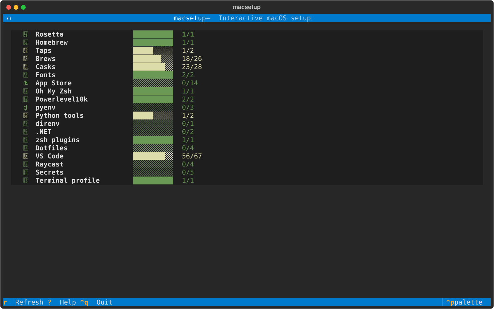
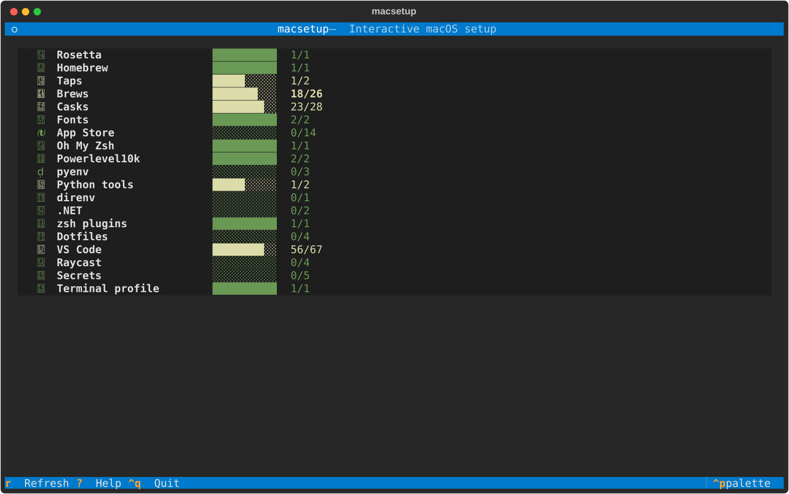
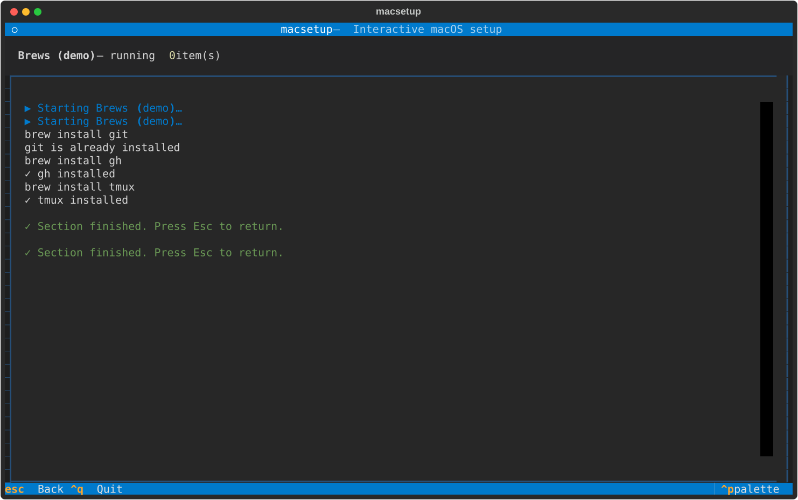
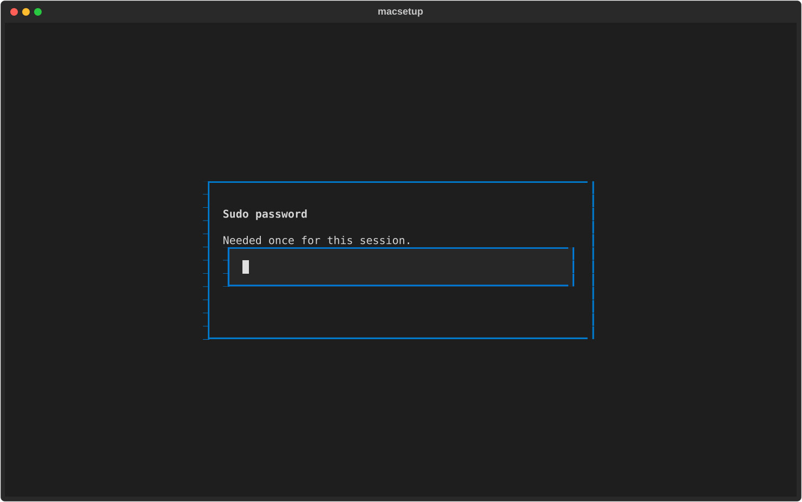
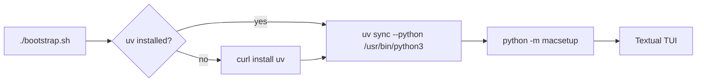
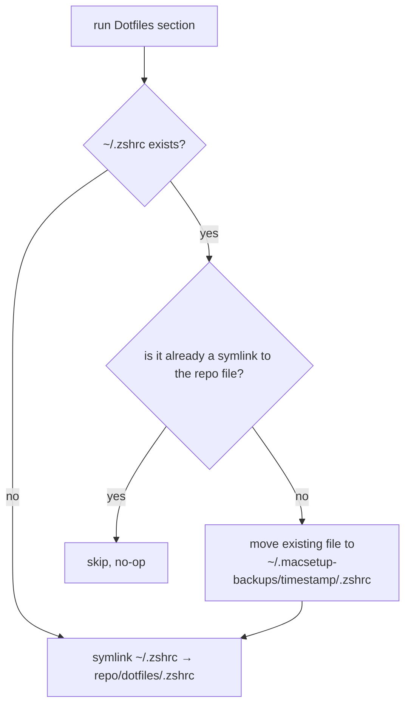
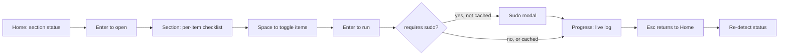

# macsetup

Interactive macOS setup tool — a Textual TUI that brings a fresh Mac to the
way you like it, with sections-as-modules, TOML-driven config, one-time sudo,
symlinked dotfiles, and live system detection.



## Quickstart

```bash
./bootstrap.sh
```

That's it. The script installs `uv` if missing, syncs a project venv against
macOS system Python (`/usr/bin/python3`), and launches the TUI. No global
Python pollution; nothing pins your pyenv versions.

## What it does

- **19 sections** covering everything from Rosetta and Homebrew through to
  VS Code extensions, Raycast, App Store apps via `mas`, and SSH/GPG key
  restoration.
- **Live detection** on Home — every section shows real installed/total
  counts against the live system. No state file to drift.
- **Per-item checklists** — pick exactly what you want before each section runs.
- **One-time sudo** — modal asks once at the start, background `sudo -v`
  keep-alive prevents subsequent prompts.
- **Symlinked dotfiles** — repo owns canonical `~/.zshrc`, `~/.zprofile`,
  `~/.p10k.zsh`, `~/.tmux.conf`. Existing files are timestamp-backed up to
  `~/.macsetup-backups/` before linking.
- **Fixes the Poetry 2.x bug** that broke the legacy script: detects Poetry
  version and only sets `virtualenvs.prefer-active-python` when Poetry < 2.0.

## Screens

**Section view** — per-item checklist with categories and descriptions.



**Progress view** — live, syntax-highlighted log streaming subprocess output.



**Sudo modal** — collected once at the start of the session.



Note: SVG previews use a generic monospace font, so Nerd Font glyphs (Apple
logo, beer mug, VS Code icon, etc.) render as boxes in the SVG. They display
correctly in a real terminal with MesloLG Nerd Font.

## How the bootstrap flow works



## How the dotfile symlinking works



## How a section runs



## Customise

### Add or remove a program

Edit the matching TOML under [config/](config/). Each entry is a single block:

```toml
# config/casks.toml — add a new cask
[[item]]
name = "arc"
description = "The browser from The Browser Company"
default = true
category = "browser"
```

Removing = delete the block. The TUI picks up changes on next launch.

### Add a new section

1. Drop a file in [src/macsetup/sections/](src/macsetup/sections/) implementing the `Section` ABC.
2. Add one line to [src/macsetup/sections/\_\_init\_\_.py](src/macsetup/sections/__init__.py) at the position you want.
3. Optionally add `config/<name>.toml` for a per-item checklist.

Sections cannot reach into each other — all cross-cutting concerns
(sudo, shell, file detection, symlinks) come from `macsetup.core.*`. A
broken section can't take down the rest of the tool.

### Disable a section without removing it

Comment out its entry in `sections/__init__.py`.

## Project layout

```text
├── bootstrap.sh                 # entry point
├── pyproject.toml               # uv project
├── config/                      # editable TOML lists (brews, casks, fonts, etc.)
├── dotfiles/                    # canonical dotfiles symlinked into $HOME
├── assets/                      # custom.terminal, VSCode workflow, screenshots
├── src/macsetup/
│   ├── app.py                   # Textual App + sudo keep-alive
│   ├── screens/                 # Home, Section, Progress, SudoModal
│   ├── sections/                # one file per install concern
│   ├── core/                    # arch, shell, detect, sudo, symlink, config
│   └── ui/                      # theme, icons, widgets
├── scripts/capture_screenshots.py
└── tests/                       # pytest suite (31 tests)
```

See [PLAN.md](PLAN.md) for the full design rationale.

## Status

This is a full rewrite of an older zsh-based setup tool. The legacy code
lives in [.old-root/](.old-root/) as **read-only reference**; do not run it.

- 31/31 tests pass
- All 19 sections implemented with real install logic
- Verified against this developer's machine end-to-end at the detection layer

## License

See [LICENSE](.old-root/LICENSE) in the archived legacy tree.
